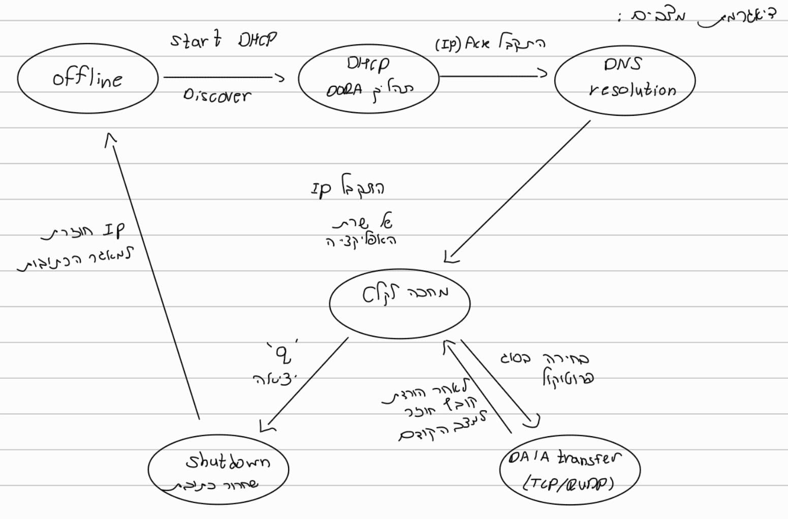

# Network Stack Simulator — DHCP · DNS · HTTP over TCP & Reliable UDP

A Python simulation of every step a client goes through to reach a web service:
it gets an IP address from a **DHCP** server, resolves the server's name through a **DNS** server,
and downloads content from an **application server** over either **TCP** or a custom **Reliable UDP (RUDP)** protocol.

Built from scratch with raw sockets as the final project of the Computer Networks course (Ariel University).



## Components

| Component | Port | Highlights |
|---|---|---|
| **DHCP server** | UDP 67 | Full DORA handshake (Discover → Offer → Request → ACK), address pool `192.168.1.100–200`, lease expiry & reclaim, `RELEASE` support, leases persisted to JSON and restored after a crash |
| **DNS server** | UDP 53 | A & CNAME records, TTL-based cache persisted to JSON, upstream resolution over **DNS-over-HTTPS** (Google, with Cloudflare fallback) |
| **App server – TCP** | TCP 80 | Thread-per-client HTTP file server |
| **App server – RUDP** | UDP 8080 | Reliability layer on top of UDP: sequence numbers, ACKs, timeouts & retransmission, sliding window (size 5), reordering buffer, checksums |
| **Client** | — | Runs the whole flow DHCP → DNS → HTTP, renews its lease in a background thread, lets the user choose TCP or RUDP, releases its IP on exit |

## Project structure

```
Client/            client.py (entry point) + dhcp/dns/tcp/rudp client logic
Servers/
  DHCP_server/     dhcp_server.py, dhcp_leases.json
  DNS_server/      dns_server.py,  dns_cache.json
  App_server/      app_server.py, tcp_handler.py, rudp_handler.py, files/
Shared/            config.py (ports, timeouts, constants), utils.py (packet build/parse, checksum)
wireshark_captures/  .pcap recordings of DHCP, DNS, TCP, UDP and packet-loss recovery
docs/              full project report in Hebrew (traffic analysis, NAT, QUIC, TCP vs QUIC, BGP vs OSPF)
```

## Running

Requires Python 3.8+ and `requests` (`pip install -r requirements.txt`). Run each part in its own terminal **from the repository root**
(ports 53/67/80 may require administrator / root privileges):

```bash
python -m Servers.DHCP_server.dhcp_server
python -m Servers.DNS_server.dns_server
python -m Servers.App_server.app_server
python Client/client.py
```

The client then asks for a file name or URL and the transport protocol (1 = TCP, 2 = RUDP), downloads it and opens it.

## Reliability under packet loss

To test the RUDP layer I injected faults into the server's send path (random packet drops and delays — see
`docs/REPORT_he.md`). `wireshark_captures/lost&delay_dealing.pcap` shows the client detecting gaps by sequence number,
the server retransmitting after timeouts, and the file arriving complete.

## Tech
Python · `socket` (TCP/UDP) · `threading` · JSON persistence · DNS-over-HTTPS · Wireshark
