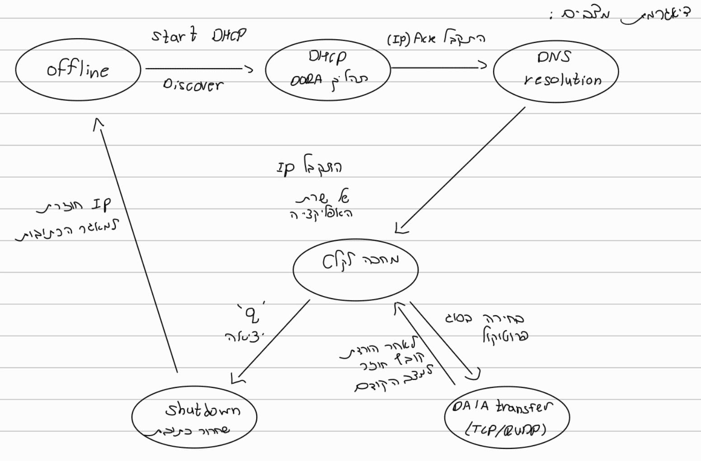

<style>
  body {
    direction: rtl;
    text-align: right;
  }
  table {
    direction: rtl;
    margin-left: auto;
    margin-right: 0;
  }
  code {
    direction: ltr;
    display: inline-block;
  }
</style>

<div dir="rtl">

# פרויקט גמר - תקשורת מחשבים
**מגיש:** כפיר נזרי

## 1. ארכיטקטורת המערכת והרכיבים
הפרויקט מממש ארכיטקטורת רשת מלאה המדמה את כל שלבי הגישה של לקוח קצה אל שרת אפליקציה באינטרנט. המערכת תוכננה כמודולרית וכוללת מנגנוני שרידות (Persistence) ושחזור נתונים מתקדמים. כתבתי בשפת פייתון את הקוד שלי תוך ארגון הקוד בתיקייות   מתאימות לכל שרת ותקייות המכילות קבצי עזר.

### א. שרת DHCP
השרת מנהל את שכבת הכתובות הלוגיות ברשת המקומית ומבטיח הקצאה תקינה ורציפה:
* **ניהול מאגר:** השרת שולט בטווח הכתובות `192.168.1.100` עד `192.168.1.200`. המערכת מוודאת מניעת התנגשויות על ידי ניהול רשימת כתובות תפוסות ופנויות בזמן אמת.
* **תהליך ה-DORA המלא:** מומשו ארבעת שלבי הפרוטוקול (Discover, Offer, Request, ACK). השרת מזהה את הלקוח לפי מזהה ייחודי ומקצה לו כתובת קבועה לאורך זמן ההשאלה.

* **מנגנון Persistence ושחזור:** כל הקצאה נשמרת לקובץ `dhcp_leases.json`. במקרה של קריסת שרת, הוא טוען את הקובץ עם עלייתו מחדש ומשחזר את תמונת הרשת. זה מבטיח שלקוחות קיימים ישמרו על הכתובת שלהם ושהשרת לא יקצה כתובת תפוסה בטעות.
* **מחזור כתובות:** השרת מפעיל מנגנון "ניקוי" אוטומטי. כתובת שה-Lease Time שלה פקע והלקוח לא ביצע עבורה חידוש מוחזרת למאגר הפנוי באופן מיידי. בנוסף, השרת תומך בהודעת `RELEASE` לשחרור יזום של הכתובת.


### ב. שרת DNS
השרת משמש כצומת לתרגום שמות דומיין לכתובות IP, תוך דגש על אבטחה ומהירות:
* **מנגנון Intelligent Caching:** כל פתרון שם נשמר במטמון מקומי (`dns_cache.json`). השרת בודק את שדה ה-TTL- אם הרשומה בתוקף, התשובה נשלחת ללקוח באופן מיידי. אם התוקף פג, השרת מבצע פנייה חוזרת (Re-fetch) ומעדכן את המחסן המקומי.

* **DNS over HTTPS:** למניעת האזנה וזיוף שאילתות, השרת פונה לספקים חיצוניים (Google ו-Cloudflare) דרך חיבור HTTPS מוצפן בפורט 443.
* **שרידות:** השרת מממש לוגיקת Fallback - במידה וספק ה-DNS הראשון אינו מגיב, השאילתה מופנית אוטומטית לספק השני כדי להבטיח רציפות שירות ללקוח.

### ג. שרת אפליקציה
שרת האפליקציה מגיש תוכן בפורמט HTTP מעל שתי שכבות תעבורה שונות:

#### פרוטוקול TCP (פורט 80):
* **ניהול חיבורים אמין:** השרת משתמש בסוקטים TCP סטנדרטיים הכוללים את תהליך לחיצת היד המשולשת. זה מבטיח הקמת קשר יציב לפני העברת בייט אחד של מידע.

* **ריבוי לקוחות (Multithreading):** השרת מבוסס על מודל `Thread-per-Client`. עבור כל לקוח שמתחבר, נפתח תהליך נפרד המטפל בבקשה שלו. מבנה זה מאפשר לשרת לשרת לקוחות רבים בו-זמנית ללא השהייה.
* **בקרת זרימה ואמינות:** השימוש ב-TCP מבטיח שכל חלקי דף ה-HTML יגיעו בסדר הנכון (Byte Stream). המערכת מטפלת באופן שקוף בחישובי Checksums, חלונות שידור ואישורי קבלה ברמת הפרוטוקול.

#### פרוטוקול Reliable UDP - RUDP (פורט 8080):
הטמעתי שכבת אמינות מעל UDP הכוללת:
    * **מספרי רצף (Sequence Numbers):** כל חבילת מידע מקבלת מספר סידורי, המאפשר ללקוח להרכיב את הקובץ בסדר הנכון ולזהות כפילויות.
    * **מנגנון ACK ו-Timeout:** השרת ממתין לאישור קבלה על כל חבילה. במידה ואישור לא הגיע תוך זמן מוגדר, השרת מבצע שידור חוזר (Retransmission).
    * **ניהול תורים:** המערכת מנהלת תור שליחה מסודר המבטיח ניצול מקסימלי של רוחב הפס מבלי להציף את הלקוח.

### צד לקוח: 

צד הלקוח מממוש בתיקיית Client.
הקובץ client.py הוא הקובץ הראשי שמריץ את ממשק המשתמש, הוא מנהל את סדר הפעולות של תהליך הגלישה- DHCP -> DNS -> HTTP ואחראי על סגירה מסודרת ושחרור כתובות.
בנוסף יש קבצי צד לקוח לשרתים השונים:

dhcp_logic.py- מממש את צד הלקוח בתקשורת מול שרת ה DHCP ומפעיל תהליך רקע שדואג לחדש את השאלת הכתובת מול השרת.

dns_logic.py- שולח שאילתות לשרת ה DNS המקומי ויודע לפרש את התשובות ולחלץ את ה IP של שרת האפליקציה.

tcp_logic.py- מממש הורדת קבצים מעל TCP ומוסיף headers מותאמים אישית להזדהות מול השרת.

rudp_logic.py- מממש הורדת קבצים מעל UDP, מנהל את ה sliding window, שליחת acks וסידור החבילות בבאפר. 

---

### קבצי עזר:  
config - בקובץ זה הגדרתי את כל הקבועים המרכזיים בפרוייקט כמו פורטים לשרתים השונים, כתובות קבועות, טיימרים ודגלים.

utils - קובץ זה מכיל פונקציות טכניות שמשמשות גם את הלקוח וגם את השרת כמו יצירת חבילות, פירוק חבילות(קריאת נתונים שהגיעו) חישוב checksum. בנוסף כתבתי שם עוד שני פונקציות עזר לפנייה לשרת חיצוני- sanitize_cache_name() לוקחת כתובת URL ומתרגמת אותה לכתובת שהמערכת תוכל לשמור ללא שגיאות. fetch_external_content() משתמשת בסיפריית urllib כדי לגלוש באתרי web.

---

### דיאגרמת מצבים:



---

## 2. ניתוח תעבורה (Traffic Analysis)


להלן ניתוח של "מסע החבילה" מרגע חיבור הלקוח ועד קבלת המידע:	

| ip des | ip src | port des | port src | application |
| :--- | :--- | :--- | :--- | :--- |
| 127.0.0.1 | 127.0.0.1 | 67 | 60939 | dhcp discover |
| 127.0.0.1 | 127.0.0.1 | 60939 | 67 | dhcp offer |
| 127.0.0.1 | 127.0.0.1 | 67 | 60939 | dhcp request |
| 127.0.0.1 | 127.0.0.1 | 60939 | 67 | dhcp ack |
| 127.0.0.1 | 192.168.1.101 | 8081 | 63313 | dns query |
| 192.168.1.101 | 127.0.0.1 | 63313 | 8081 | dns response |
| 127.0.0.1 | 192.168.1.101 | 80 | 54377 | tcp_http request |
| 192.168.1.101 | 127.0.0.1 | 54377 | 80 | tcp_http response |
| 127.0.0.1 | 192.168.1.101 | 8080 | 63301 | udp_http request |
| 192.168.1.101 | 127.0.0.1 | 63301 | 8080 | udp_http_response |

---

## 3. השפעת NAT ושימוש בפרוטוקול QUIC

### השפעת רכיב NAT על תעבורת הרשת
במידה והיה ממוקם רכיב NAT (Network Address Translation) בין המשתמש לשרתים, היינו מבחינים בשינויים מהותיים במבנה החבילות ובהתנהגות השרת:

1.  **שינוי כתובות ופורטים (PAT):** ברמת שכבת ה-IP, הנתב היה מחליף את כתובת המקור הפרטית של הלקוח (`192.168.1.101`) בכתובת ה-IP הציבורית שלו. מכיוון שסביר שישנם לקוחות נוספים ברשת הפנימית, הנתב היה משתמש ב-Port Address Translation (PAT) ומשנה גם את פורט המקור לפורט ייחודי שהוא מקצה בטבלת הנתוב שלו.

2.  **חוסר עקביות במידע:** במערכת שלי, הלקוח מזדהה באמצעות Header מיוחד בשם `X-Assigned-IP`. בעוד שה-NAT משנה את כתובת ה-IP בכותרת החבילה, הוא לא נוגע בתוכן האפליקציה. מצב זה יוצר סתירה: השרת יקבל חבילה המגיעה מכתובת ציבורית, אך בתוך הודעת ה-HTTP יופיע זיהוי של כתובת פרטית. כדי לתמוך בכך, השרת צריך לדעת לנהל את הקשר הלוגי על בסיס ה-Header הייעודי ולא להסתמך רק על כותרת ה-IP הגולמית.

### היתרונות במעבר לפרוטוקול QUIC
שימוש בפרוטוקול QUIC (המבוסס על UDP) היה משדרג את ביצועי המערכת ועמידותה באופן ניכר, במיוחד בסביבה הכוללת NAT:

* **שרידות החיבור:** בשונה מ-TCP המזהה חיבור לפי IP ופורט של מקור ויעד, QUIC משתמש ב-**Connection ID** ייחודי. המשמעות היא שאם המשתמש עובר בין רשתות  או שה-NAT מבצע "Re-binding" לפורט, החיבור לא מתנתק. השרת מזהה את ה-ID וממשיך את השידור ללא צורך בהקמת חיבור מחדש.
* **צמצום השהייה:** QUIC מבצע את לחיצת היד  של התעבורה ושל האבטחה בו-זמנית. הדבר חוסך  RTT יקרים ומאפשר ללקוח להתחיל לקבל את תוכן האתר כמעט באופן מיידי.

* **פתרון בעיית ה-Head-of-Line Blocking:** במימושים כמו RUDP או TCP, אובדן של חבילה אחת עוצר את כל זרם המידע עד לשליחתה החוזרת. QUIC מאפשר מספר זרמים (Streams) עצמאיים, כך שאובדן חבילה בזרם אחד לא מעכב את טעינת שאר חלקי דף ה-HTML בזרמים אחרים.

---
## 4. שאלות והרחבה תאורטית

### 1. הבדלים עיקריים בין פרוטוקול TCP ל-QUIC
* **שכבת התעבורה:** TCP פועל ישירות מעל ה-IP, בעוד ש-QUIC רץ מעל **UDP**.
* **מהירות הקמת החיבור:** TCP דורש לחיצות יד נפרדות עבור התעבורה והאבטחה. QUIC משלב אותן ומאפשר **0-RTT**.
* **מניעת חסימת ראש תור:** ב-TCP, אובדן חבילה עוצר את כל השידור. ב-QUIC, הזרמים עצמאיים.
* **ניידות חיבור:** QUIC משתמש ב-**Connection ID** במקום להסתמך על IP ופורט, מה שמונע ניתוקים במעבר בין רשתות.

### 2. הבדלים בין : Cubic ו-Vegas
* **מנגנון הזיהוי:** **Cubic** הוא מבוסס אובדן (Loss-based) – הוא מאט רק כשחבילה הולכת לאיבוד. **Vegas** הוא מבוסס השהייה (Delay-based) – הוא מזהה עומס לפי עלייה ב-RTT ומאט מראש.
* **אגרסיביות:** Cubic אגרסיבי מאוד ומנסה לנצל את רוחב הפס המקסימלי במהירות. Vegas עדין יותר ומנסה למנוע הצפת תורים.

### 3. פרוטוקול BGP לעומת OSPF ובחירת מסלולים

פרוטוקול **BGP (Border Gateway Protocol)** הוא פרוטוקול ניתוב מסוג **Path-Vector** . תפקידו הוא לנהל את הניתוב בין מערכות אוטונומיות. בשונה מפרוטוקולים פנימיים, BGP לא רק מחליף מידע על רשתות, אלא גם על הנתיב המלא  שיש לעבור כדי להגיע ליעד.

**במה הוא שונה מ-OSPF?**
ההבדלים בין הפרוטוקולים נובעים מההקשר שבו הם פועלים:
1. **היקף הפעולה:** **OSPF** הוא פרוטוקול פנימי שנועד לנתב בתוך ארגון בודד. **BGP** הוא פרוטוקול חיצוני שנועד לקשר בין ארגונים וספקי אינטרנט שונים.
2. **אלגוריתם הניתוב:** OSPF משתמש באלגוריתם **Dijkstra (Link-State)** המבוסס על מטריצת עלויות. BGP משתמש באלגוריתם המבוסס על תכונות ועל חוקי מדיניות שהוגדרו מראש.
3. **אמינות:** OSPF רץ לרוב ישירות מעל ה-IP או ב-Multicast מקומי. BGP דורש אמינות גבוהה ולכן הוא פועל מעל **TCP**.

BGP לא בהכרח עובד על פי מסלולים קצרים. 
בעוד ש-OSPF תמיד יחפש את המסלול בעל ה-"Cost" הנמוך ביותר (המסלול המהיר/קצר ביותר טכנית), BGP הוא פרוטוקול המבוסס על מדיניות.

* **שיקולי יעילות:** BGP עשוי לבחור במסלול ארוך יותר משמעותית אם הוא זול יותר כספית, או אם מנהל הרשת הגדיר להימנע ממעבר דרך מדינה משיקולי אבטחה.
* **סדר העדיפויות (Attributes):** המדד ל"מרחק" ב-BGP הוא אורך ה-**AS-Path**. עם זאת, ב-BGP קיימת היררכיית החלטות שבה ה-**Local Preference** קודמת ל-AS-Path. כלומר, אם הוגדרה עדיפות למסלול מסוים, הנתב יבחר בו גם אם הוא עובר דרך הרבה יותר תחנות בדרך ליעד.


### 4. הבדלים בין פרוטוקול ARP ל-DNS
* **מטרת התרגום:** **ARP** מתרגם IP לכתובת MAC פיזית. **DNS** מתרגם שם דומיין לכתובת IP לוגית.
* **שכבת המודל:** ARP פועל בשכבות 2/3 (רשת מקומית). DNS פועל בשכבה 7 (אפליקציה עולמית).
* **שיטת עבודה:** ARP משתמש ב-**Broadcast** ברשת המקומית. DNS משתמש במערכת שרתים היררכית מבוזרת.

---

<div dir="rtl">

#  כיווני פיתוח והרחבות עתידיות:

כדי להפוך את המערכת למוצר ברמת Production המסוגל לשרת אלפי משתמשים בו-זמנית, ניתן לממש את השדרוגים הבאים:

### 1. מעבר ל-Asynchronous I/O (asyncio)
כיום המערכת משתמשת במודל **Thread-per-Client**. במערכת מסיבית, ניהול אלפי תהליכונים ייצור עומס כבד על הזיכרון (RAM) ועל המעבד כתוצאה מ-Context Switching מרובה.
* **הפתרון:** שימוש בספריות כמו `asyncio` או `Selector` יאפשר לשרת בודד לנהל אלפי חיבורים בו-זמנית על גבי תהליכון (Thread) יחיד בצורה יעילה וחסכונית במשאבים.

### 2. אבטחה והצפנה (Encryption)
בגרסה הנוכחית, המידע עובר כ-**Plaintext**, מה שחושף את המערכת להתקפות ציתות ושינוי נתונים (Man-in-the-Middle).
* **הפתרון:** הוספת שכבת **TLS/SSL** מעל ה-TCP ומימוש הצפנה מקצה לקצה (End-to-End Encryption) בתוך פרוטוקול ה-RUDP כדי להבטיח את פרטיות ואמינות המידע.

### 3. מימוש מלא של פרוטוקול QUIC
החלפת שכבת ה-RUDP שמימשנו במימוש מלא של פרוטוקול **QUIC** (הבסיס ל-HTTP/3).
* **היתרונות:** QUIC משלב אבטחה מובנית בתוך לחיצת היד ומציע עמידות גבוהה במיוחד לאובדן חבילות.

### 4. בקרת גודש דינמית (Congestion Control)
כיום גודל החלון (Sliding Window) במערכת הוא סטטי ואינו מגיב לשינויים בתנאי הדרך.
* **הפתרון:** הרחבה עתידית תכלול אלגוריתם בקרת גודש דינמי כגון **TCP BBR** או **Cubic**.

---

### סימולציית איבוד חבילות והשהיות

בשביל לבדוק איך הקוד מתמודד עם איבוד חבילות והשהיות הזרקתי את הפונקציה הבאה לקוד:

```python
def send_with_faults(data, addr):
    if random.random() < TEST_PACKET_LOSS_RATE:
        print(f"[FAULT INJECTION] Outgoing packet DROPPED! (Loss Simulation)")
        return 
    
    if random.random() < TEST_LATENCY_CHANCE:
        print(f"[FAULT INJECTION] DELAYING outgoing packet by {TEST_LATENCY_DELAY}s...")
        time.sleep(TEST_LATENCY_DELAY)
    
    sock.sendto(data, addr)
```

ניתן לראות בקובץ המצורף lost&delay_dealing.pcap את חבילות ה UDP ולהבין כי השרת הצליח להתגבר על התקלות והוריד את הקובץ בשלמותו.

מאחר שפרוטוקול UDP בבסיסו אינו מבטיח הגעה של מידע ליעדו, מימשתי שכבת אמינות (Reliable UDP) המשתמשת במספר מנגנונים משולבים כדי להבטיח שכל בייט של מידע יגיע בצורה תקינה ובסדר הנכון.

### 1. מספרי רצף (Sequence Numbers)
כל חבילת מידע שיוצאת מהשרת מקבלת מספר סידורי ייחודי בתוך ה-Header של ה-RUDP.
* **זיהוי חוסרים:** מספרי הרצף מאפשרים ללקוח לדעת בדיוק איזה מידע הוא מצפה לקבל. אם הגיעה חבילה מספר 5 ואחריה חבילה מספר 7, הלקוח מזהה מיד שחבילה מספר 6 אבדה בדרך.
* **מניעת כפילויות:** במקרה שחבילה נשלחה פעמיים (עקב שידור חוזר), הלקוח מזהה את מספר הרצף הכפול ומתעלם מהחבילה המיותרת כדי למנוע הריסה של הקובץ.

### 2. אישורי קבלה (ACKs - Acknowledgements)
על כל חבילה שהלקוח מקבל, הוא מחזיר לשרת חבילת אישור המכילה את מספר הרצף הבא שהוא מצפה לקבל.
* **Cumulative ACK:** הלקוח מאשר את החבילה האחרונה שהגיעה ברצף תקין. מנגנון זה מאפשר לשרת לדעת עד איזו נקודה המידע הגיע בשלום ובכך לנהל את חלון השידור (Sliding Window) בצורה יעילה.


### 3. מנגנון פקיעת זמן (Timeout) ושידור חוזר (Retransmission)
זהו המנגנון המרכזי המאפשר למערכת להתאושש מאובדן מידע ברשת:
* **בצד השולח (השרת):** לאחר שליחת חבילה, השרת מפעיל טיימר. אם הטיימר מסתיים (Timeout) והשרת טרם קיבל ACK מהלקוח עבור אותה חבילה, השרת מניח שהחבילה אבדה ברשת.
* **שידור חוזר:** השרת מבצע שידור חוזר של החבילה שלא אושרה. תהליך זה חוזר על עצמו עד לקבלת אישור קבלה מהלקוח, מה שמבטיח שגם תחת תנאי רשת קשים, המידע יגיע בסופו של דבר ליעדו.


### 4. באפר סידור מחדש (Reordering Buffer)
לעיתים חבילות אינן הולכות לאיבוד, אלא פשוט מגיעות בסדר שונה מזה שנשלחו.
* המערכת מנהלת באפר זמני בתוך הלקוח (Receive Buffer). חבילות שהגיעו "לפני הזמן" (מספר רצף גבוה מהצפוי) נשמרות בבאפר.
* ברגע שהחבילה החסרה מגיעה, המערכת מכניסה את המידע מהבאפר בסדר הנכון ומעבירה אותו לאפליקציה כזרם נתונים רציף ותקין.

### 5. חלון גלישה (Sliding Window)
מנגנון זה מאפשר לשפר משמעותית את ביצועי הרשת על ידי שליחת מספר חבילות במקביל, מבלי להמתין לאישור על כל אחת בנפרד.

* ניצול רוחב פס: בניגוד לשיטת "עצור והמתן", חלון הגלישה מאפשר לשלוח כמות נתונים מוגדרת מראש ("גודל החלון") לפני שצריך לעצור להמתנת ACK.

* בקרת זרימה: ככל שמתקבלים אישורים (ACKs) מהלקוח, החלון "גולש" קדימה בזרם הנתונים ומאפשר שליחת חבילות חדשות, מה שיוצר רצף שידור מהיר ויעיל.
</div>